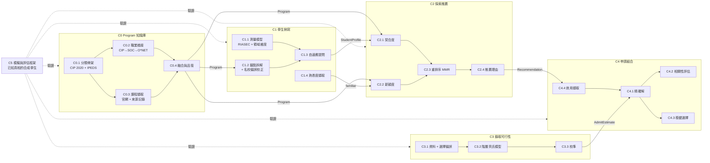

# 演算法架構 Algorithm Architecture

> 讀法：先看 §1 設計原則與 §2 部件圖，再依需要看各部件規格（`docs/components/`）。
> 每個部件的理論來源見 [THEORY.md](THEORY.md)，假設與盲區見 [REGISTER.md](REGISTER.md)，驗證方式見 [VALIDATION.md](VALIDATION.md)，工項見 [ROADMAP.md](ROADMAP.md)。

## 1. 設計原則

| ID | 原則 | 為什麼 | 落實方式 |
|---|---|---|---|
| D1 | **需求空間與標籤空間分離** | 學生不知道 program 名稱，但知道自己想做什麼。「契合」看內容，「新穎」看名稱 | C2 的 relevance 只用屬性向量，novelty 只用 CIP／熟悉度 |
| D2 | **Program 屬性雙重測量** | 單一資料來源（官網文案或分類代碼）都有系統性偏誤，兩個獨立來源互相檢驗 | C0.2 職業橋接 vs C0.3 課程擷取，C0.4 比對一致性 |
| D3 | **需求維度錨定在已驗證的構念** | 自訂維度沒有信效度保證 | C1.1 以 Holland RIASEC（O*NET 使用的興趣模型）為骨架，再加通過因素分析的領域維度 |
| D4 | **不確定性端到端傳遞** | 點估計會讓下游過度自信 | C1 輸出後驗標準差、C3 輸出區間、C4 用區間做穩健選擇 |
| D5 | **部件只透過資料契約溝通** | 單獨開發、單獨驗證、可替換 | `src/aisc/contracts.py`；部件之間不互相 import 內部函式 |
| D6 | **先模擬驗證，再真人驗證** | 真人資料少且昂貴，演算法錯誤要先在已知真相的環境抓出來 | C5 模擬器提供已知的真實需求，每個部件都要先過 L3 |
| D7 | **新穎 = 學生不知道，而非分類距離遠** | 分類距離只是代理變數 | C1.4 熟悉度擷取，C2.2 v1 改用「未知機率」 |
| D8 | **每個版本保留參考實作** | 新版本必須能和舊版本、暴力法比對 | 例如 C4.1 精確解永遠保留，C4.2 只是評估它的誤差 |

## 2. 部件圖



## 3. 部件總表

> 各部件的目前狀態只記在 [VALIDATION.md §5](VALIDATION.md)，此表只描述設計。

| 部件 | 輸入 → 輸出（契約） | 核心方法 | 規格 |
|---|---|---|---|
| **C0** Program 知識庫 | 公開資料 → `Program` | 分類骨架 + 雙重測量 + 一致性品管 | [C0](components/C0-catalog.md) |
| **C1** 學生側寫 | 問卷回答、錨點、熟悉度 → `StudentProfile`（完整 15 維） | RIASEC 測量模型 + 錨點先驗 + 貝氏自適應問卷 + 熟悉度擷取 | [C1](components/C1-profiling.md) |
| **C2** 探索推薦 | 完整 `StudentProfile` + `Program` → `DiscoveryResult` | 依契合排序 + 熟悉度分區（v1）；v0 新穎度加權保留為參考；可忠實分解的理由 | [C2](components/C2-discovery.md) |
| **C3** 錄取可行性 | 歷史結果 → `AdmitEstimate` | 階層貝氏 logistic + 選擇偏誤處理 + 校準 | [C3](components/C3-feasibility.md) |
| **C4** 申請組合 | `Recommendation` + `AdmitEstimate` → `PortfolioResult` | Kapur & Hong 精確解 + copula 相關性 + 穩健最佳化 | [C4](components/C4-portfolio.md) |
| **C5** 模擬與評估 | 合成族群 → 各部件指標 | 已知真相模擬 + 消融 + 盲區探針 | [C5](components/C5-simulation.md) |

## 4. 數學定義（v0）

**符號**：program $p$ 的屬性 $x_p \in [0,1]^d$、標籤 $\ell_p$（6 碼 CIP）；學生需求 $w \in [0,1]^d$、不確定性 $\sigma$；錨點集合 $K$、熟悉集合 $F$。

| 部件 | 定義 | 程式 |
|---|---|---|
| C1.2 | $\hat w = \dfrac{w^{s}/\sigma_s^2 + \bar x_K/\sigma_a^2}{1/\sigma_s^2 + 1/\sigma_a^2}$，$\sigma_a = \sigma_0/\sqrt{\lvert K\rvert}$ | `profiling/anchors.py` |
| C1.2 v1 | 錨點先驗 $\bar x_K$、$\sigma_K = \frac{\sigma_0}{\sqrt{\lvert K\rvert}}(1+\beta\max(0,z_{\text{prestige}}))$；未作答維度：中性先驗 $(0.5, 0.3)$ 與錨點先驗精度加權；已作答維度：陳述值，錨點標準差 × `answered_scale`（預設 ∞） | `profiling/anchors.py` |
| C1.3 v1 | 回答 $y = w_d + \varepsilon$，$\varepsilon \sim N(0, 0.25^2)$；更新 $\mu_d \leftarrow \frac{\mu_d/\sigma_d^2 + y/0.25^2}{1/\sigma_d^2 + 1/0.25^2}$。辨別性：$\arg\max_d \sigma_d^2 \operatorname{Var}_{p \in \text{top-}20}(x_{p,d})$；資訊價值：$\arg\max_d \mathbb{E}_y[1 - \lvert T_{10}(\mu) \cap T_{10}(\mu^{(d,y)})\rvert / 10]$ | `profiling/adaptive.py` |
| C2.1 | v0：$\text{rel}(p) = \cos(\hat w, x_p)$；候選：分層 $\cos - \gamma\,\overline{(\hat w_d - x_{p,d})^2}_{d \in I}$、混合 $(1-\lambda)\cos + \lambda(1 - \overline{(\hat w_d - x_{p,d})^2})$、平方距離；$I$ = 強度層 | `discovery/scoring.py`、`discovery/scorers.py` |
| C2.2 | $\text{nov}(p) = 1 - \max_{q \in K \cup F} \text{sim}_\ell(p,q)$；$\text{sim}_\ell$ = 1（同 4 碼）/ 0.5（同 2 碼）/ 0；$p \in F \Rightarrow 0$ | `discovery/scoring.py` |
| C2.3 | $\text{score} = (1-\alpha)\,\text{rel} + \alpha\,\text{nov}$；MMR：$\arg\max (1-\lambda)\text{score} - \lambda \max_{q \in S}\cos(x_p,x_q)$ | `discovery/rerank.py` |
| C2.4 | $c_k = w_k x_{p,k} / (w \cdot x_p)$，$\sum_k c_k = 1$（精確分解） | `discovery/scoring.py` |
| C2.3 v1 | 短名單 $L = \text{top-}n$ 依 $\text{rel}$（排除錨點）；回報熟悉集合 $\hat F \subseteq L$；發現區 $= \text{top-}k$ of $\{p \notin \hat F\}$，已知區 $= \text{top-}k'$ of $\{p \in \hat F\}$，皆依 $\text{rel}$ | `discovery/sectioned.py`、`pipeline.py` |
| C4.1 | $v(S) = \sum_i u_{j_i} p_{j_i}\prod_{l<i}(1-p_{j_l})$；DP $V_j(b)=\max\{V_{j-1}(b),\, p_ju_j+(1-p_j)V_{j-1}(b-c_j)\}$ | `portfolio/solvers.py` |

v1 的改動（例如 C2.1 改成考慮強度的距離、C2.2 改成未知機率）寫在各部件規格，並以 L4 探針測試鎖定。

## 5. 程式結構

```
src/aisc/
  contracts.py      # 部件之間唯一的共用型別
  pipeline.py       # 系統層：只透過各部件公開 API 串接（C2 短名單 → C1.4 熟悉度 → C2.3 v1）
  dimensions.py     # 需求維度登錄 v1：4 層 15 維（docs/rubric.md）
  catalog/          # C0
  profiling/        # C1
  discovery/        # C2
  feasibility/      # C3
  portfolio/        # C4
  simulation/       # C5
tests/
  test_contracts.py
  test_c0_*.py … test_c4_*.py   # 每個部件一組；@pytest.mark.probe 為盲區探針
```
