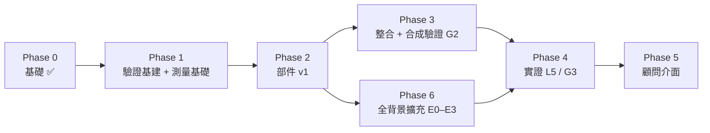

# 工項 Work Breakdown

狀態符號：✅ 完成 · 🟡 進行中 · ⏸ 暫停（原因寫在該列；C3、C4 相關工項是範圍決策 [ARCHITECTURE D13](ARCHITECTURE.md)）

預設決策（可改）：Python · MIT · 先服務**顧問** · 側寫先用**結構化問卷** · MVP 限定 **商管 × 數據 × 工程管理**。

## 工項完成的定義（Definition of Done）
每個工項關閉前必須同時滿足：
1. 程式與測試在同一個 PR，CI 全綠；
2. 對應的 L 層驗證已執行，結果寫進 PR 描述；
3. [REGISTER.md](REGISTER.md) 已更新：新假設、新盲區、狀態變化；
4. [VALIDATION.md](VALIDATION.md) §5 狀態表已更新；
5. 若修好盲區：探針的 `xfail` 已移除；
6. 若改變使用方式（新功能、API 或參數變更、輸出改變、限制解除）：[USAGE.md](USAGE.md) 對應章節、§1 功能狀態表與 §8 變更紀錄已更新（W-05）。

## 階段總覽

## Phase 0 — 基礎 ✅

| ID | 工項 | 部件 | 驗證 | 狀態 |
|---|---|---|---|---|
| W-00 | Repo、CI、規範 | — | CI | ✅ |
| W-01 | 資料契約與部件化程式結構 | 全部 | L2 | ✅ |
| W-02 | 驗證框架、假設與盲區登錄表、理論對照 | 全部 | L1 | ✅ |
| W-03 | C4.1 精確解 + 暴力法驗證；C2 v0；C1.2 v0 | C1/C2/C4 | L2 | ✅ |
| W-04 | 盲區探針：B-C1-2、B-C2-2、B-C2-3（皆確認失敗） | C1/C2 | L4 | ✅ |
| W-05 | 使用說明 [USAGE.md](USAGE.md)（安裝、示範、逐步 API、顧問流程、限制、變更紀錄）；範例由 `tests/test_usage_doc.py` 在 CI 執行。**持續工項**：之後每個改變使用方式的工項都要同步更新（完成定義第 6 條） | 全部 | L2 | ✅ 首版；持續更新 |
| W-06 | README 自動同步：`scripts/update_readme.py` 從來源檔產生 README 的「目前狀態」（USAGE §1）、「最近更新」（USAGE §8）、「下一步」（本檔）、「最新驗證結論」（VALIDATION §5）與版本號（USAGE §8 → pyproject、`__init__`、USAGE 標頭）；`.github/workflows/readme.yml` 在合併到 main 後自動重產並 commit | 全部 | L2 | ✅ |

## Phase 1 — 驗證基建 + 測量基礎

| ID | 工項 | 部件 | 產出 | 驗證／關卡 | 處理項目 | 依賴 |
|---|---|---|---|---|---|---|
| **W-10** ✅ | 合成學生產生器 v1 | C5.1 | 原型混合需求、背景科系、熟悉度（logistic）、錨點（MNL：契合 × 名氣）、作答偏誤；合成學程目錄 | L2 分布檢查 16 項 ✅ | B-C1-2、B-C1-4/5 的情境基礎 | W-01 |
| **W-11** ✅ | 指標庫 | C5.2 | RMSE、Kendall τ-b、Recall@k、相關率＋新穎相關率、最佳契合保留、覆蓋率、熱門度 KL、Brier、區間涵蓋率 | L2 手算測試 ✅（τ-b 與 scipy 交叉驗證） | — | W-01 |
| W-12 🟡 | 消融執行器 + 盲區情境集 | C5.3/C5.4 | 執行器 + 2 個基準 + 首次 L3 報告 ✅；盲區情境集 ⬜ | L2 | 全部 B 項目 | W-10、W-11 |
| **W-13** ✅ | 第二套生成模型（不同家族） | C5.5 | 無原型的 logistic-normal，RIASEC 依 Holland 六角形相關；`compare_l3.py` 比較工具 | L2 ✅（含「非叢集」檢查）、L3 ✅ | **S-1**（部分） | W-10 |
| **W-14** ✅ | CIP 2020 + IPEDS 擷取與篩選 | C0.1 | `catalog/reference.py`、`scripts/build_reference.py`、`data/reference/mvp_scope.json`；`data/reference/`（附來源、日期、SHA-256） | L2 ✅；真實資料 IPEDS 2025 建置完成（F48、F49） | B-C0-4、B-C0-6、B-C0-7 | — |
| **W-15** ✅ | 職業橋接 v1 | C0.2 | `catalog/occupation.py`；$x^{occ}$（RIASEC，等權） | G0 ✅ → L2 ✅；真實資料 73／77 CIP 有剖面（F50–F52）；L4：B-C0-1、B-C0-8 探針 | A-C0-2/3/6、B-C0-1/2/8/9 | W-14 |
| **W-16a** ✅ | 需求維度設計 | C1.1 | [rubric.md](rubric.md)：四層 15 維、學生端題型、學程端評分準則 | G0 ✅（2026-10-25 確認 Q1–Q4） | **B-C1-1**、B-C1-7/8 | — |
| **W-16b** ✅ | 維度程式遷移 + 大考中心分數先驗 | C1.1 | `dimensions.py` 15 維（含分層）、合成原型與 7 類學生原型、`profiling/ceec.py`；重跑 L3 v1 | L2 ✅、L3 ✅ | B-C1-1、B-C1-7 | W-16a |

## Phase 2 — 部件 v1

| ID | 工項 | 部件 | 產出 | 驗證／關卡 | 處理項目 | 依賴 |
|---|---|---|---|---|---|---|
| W-20 🟡 | 黃金標準 30 筆（兩位評分者；候選清單：[w20-candidates.md](../results/w20-candidates.md)，同時作為 W-76 刺激物）；**評分表與預先登記的一致性分析已備**（[w20-rater-guide.md](w20-rater-guide.md)；v2 只評 4 個維度，rubric §4 已依 B-C0-19 修訂） | C0.3、C6.3 | 人工標註 + κ：15 個需求維度**＋入學條件**（類別、必修／建議、原文、是否接受線上學分、可否錄取後補修）；樣本含 ≥ 6 筆條件明確的學程與 ≥ 4 筆範圍外學程（檢查評分準則能否跨領域） | L5 V-C0-3、V-C6-1/2 | B-C0-3、B-C0-1/7/8/9、B-C6-1/2 | W-16、W-60 |
| W-21 🟡 | LLM 課程擷取（附原文片段） | C0.3 | $x^{cur}$；**前導 v0 完成**：30 個 W-20 候選學程的 4 個未測量維度（[w21-pilot.md](w21-pilot.md)，未驗證、引文未逐字核對；創業取向 22／30 缺值） | L5 V-C0-2 ≥ 90% | B-C0-3、A-C0-5 | W-20 |
| W-22 🟡 | 融合與不一致審查佇列 | C0.4 | 最終 $x_p$ + 品質旗標；v2 階層收縮的數學與 L2 ✅（`catalog/fusion.py`：後驗平均、經驗貝氏 τ、標準化不一致旗標），等 W-21 的課程證據 | L5 V-C0-4 | B-C0-1/2/3/9 | W-15、W-21 |
| **W-77** 🟡 | 真實學程目錄 v0：IPEDS 2025 碩士「學校 × CIP」＋ C0.2 職業剖面（v2 維度） | C0.1、C0.2 | `catalog/real.py`、`scripts/build_real_catalog.py`：17,552 個學程（863 個 CIP、1,668 所學校；畢業人數 ≥ 10）；強度與取向未測量，以共用暫填值代入並標示 | L2 ✅（`test_c0_real_catalog.py`：來源欄位、暫填值對排序中立、端到端與報告）；B-C1-32 已修 | B-C0-18、A-C0-15、A-C0-16 | W-15、W-71 |
| **W-23** ✅ | 錨點拆解 v1：錨點只作為未作答維度的先驗＋名氣放寬；修正未作答維度補 0（B-C1-14） | C1.2 | `blend_profile_v1`、`pipeline.prepare_profile`、`scripts/run_l3_c1.py`、`check_fill_c2.py` | L2 ✅；L3 ✅ 預先登記選擇失敗 → 確認候選在新種子通過（144 條件 0 顯著更差） | **B-C1-2** ✅、B-C1-9、**B-C1-10** ✅、**B-C1-14** ✅ | W-10 |
| **W-24** ✅ | 熟悉度擷取（三級回答、短名單提問）＋ C5 回報誤差模擬（訊號偵測） | C1.4 | `profiling/familiarity.py`、`simulation/respondent.py` | L2 ✅、L3 ✅（F12：雜訊是關鍵槓桿） | B-C1-6、B-C1-12、B-C2-1 | W-10 |
| **W-25** 🟡 | 題庫 + 自適應選題（4 種策略） | C1.3 | `profiling/adaptive.py`、`pipeline.run_questionnaire`、`scripts/run_l3_adaptive.py` | L2 ✅（含校準）；L3：V-C1-4 ✅、**V-C1-3 ❌**（節省 13–28%，兩次執行，F24）；L4：B-C1-5 探針 | B-C1-4、**B-C1-5**（已量化） | W-16、W-10、W-11 |
| **W-25b** ✅（負面結果） | C1.3 v2 題目雜訊模型：estimated（常態估計）、censored（截斷概似）、censored_within（只用重複題學雜訊） | C1.3 | `AdaptiveSession(noise_model=...)`（非預設）、`scripts/run_l3_noise.py` | L2 ✅；L3：兩次預先登記執行皆無合格候選，**V-C1-8 ❌**（可校準的模型都傷排序，F42–F47）；L4：B-C1-16、B-C1-17、B-C1-18 探針 | B-C1-5、B-C1-16、B-C1-17、B-C1-18 | W-25 |
| **W-26** ✅ | 契合度 v1：計分器介面 + 預先登記 maximin 選擇 | C2.1 | `discovery/scorers.py`；`DEFAULT_SCORER` = blend(0.25)；`scripts/run_l3_c2_scorer.py` | L4 無尺度探針通過 ✅；L3：16 條件無顯著較差、新種子重選同一個 ✅；端到端回歸 ✅ | **B-C2-3** ✅（力道小，F38）、B-C5-5（新） | W-12 |
| W-27 ⏸ | 新穎度 v1（未知機率）：大部分被 W-24／W-28 取代，只剩短名單外學程（B-C2-7 影響 ≤ 1.5%），暫緩 | C2.2 | — | — | B-C2-7 | W-24 |
| **W-28** ✅ | 重排序 v1：分區呈現（依契合排序＋熟悉度分區）取代加成式新穎度 | C2.3 | `discovery/sectioned.py`、`pipeline.py` | L4 探針 v1 通過 ✅；L3 ✅ 相關且不知道高於純契合 12/12（中度雜訊內） | **B-C2-2** ✅、B-C2-4 | W-12、W-24 |
| **W-29** ✅ | 相關性評估器 | C4.2 | `portfolio/correlated.py`（copula Monte Carlo、`recommend_portfolio`）、`scripts/run_l3_portfolio_corr.py` | L2 ✅（ρ=0 對解析值、ρ=1 對封閉解）；L3 V-C4-2 ✅：高估 3–23%，選擇遺憾 ≤ 3.5%，預設維持 C4.1（F109–F112） | **B-C4-1** ✅ | W-11 |
| **W-2A** ✅ | 穩健選擇 | C4.3 | `portfolio/robust.py`（最壞情況、最小化最大遺憾）、`scripts/run_l3_portfolio_robust.py` | L2 ✅（對解析值、對窮舉）；L3 V-C4-3 ✅：估計誤差代價 ≤ 3.2%，穩健準則未改善，預設維持點估計（F120–F123） | **B-C4-2** ✅ | W-29 |
| **W-60** ✅ | 條件差距 v0：契約（`RequirementItem`、`StudentRecord`、`RequirementGap`）＋跨領域條件類別 draft-0＋確定性比對；D9 守門測試 | C6.1、C6.2 | `requirements/gap.py`、`data/reference/requirement_taxonomy.json` | G0 ✅、L2 ✅；類別表待使用者審閱 | B-C1-8、B-C6-1/2 | — |
| **W-61** ✅ | 學經歷紀錄輸入：多學位、已修課程對應類別（附台灣課名例子）、考試、經驗 | C1、C6.4 | JSON 輸入（`profiling/record_intake.py`）→ `StudentRecord`（新增 `online_only`、`unmapped`）；台灣課名對應表 `course_name_map_tw.json` draft-1（**待使用者確認**）；報告條件差距卡 | G0 ✅、L2 ✅（`test_c6_record_intake.py`，V-C6-5）；W-41 認知訪談待做 | B-C6-2、B-C6-10～12、A-C6-2、A-C6-10～13 | W-60 |
| W-62a | 探索模式（核心）：管線輸出推薦＋差距卡；預設流程與示範不載入 C3／C4（D13） | 系統 | `pipeline`、`report` 接上 C6 差距卡；核心不載入 `aisc.feasibility`／`aisc.portfolio`（`plan_applications` 內延遲載入 C4） | L2；D9 檢查；差距卡 ✅（W-61，報告 §4 條件差距卡）；`test_module_boundary.py`（新的直譯器載入核心與執行示範） | A-C6-3、B-C6-1 | W-60、W-61 |
| W-62b ⏸ | 申請模式（⏸ 暫停，D13）：學生設定申請日期才啟動 C3／C4 | 系統 | **申請組合部分已完成並凍結**：`plan_applications`（推薦＋AdmitEstimate → C4.1／C4.3，附 C4.2 敏感度；不回饋推薦），介面由 `test_interface_freeze.py` 固定 | L2 ✅（`test_pipeline_application.py`，含 D9 檢查）；申請日期觸發暫緩 | A-C6-3 | W-62a |

## Phase 3 — 整合與合成驗證（G2）

| ID | 工項 | 產出 | 驗證／關卡 | 處理項目 | 依賴 |
|---|---|---|---|---|---|
| W-30 🟡 | 端到端管線（合成族群） | C1 → C2 端到端 L3 ✅（`scripts/run_l3_e2e.py`，兩次執行，F30–F34）；C0 真實目錄與 C4 申請組合尚未納入 | V-S-3 ✅ | — | Phase 2 |
| W-31 🟡 | 跨生成模型重現 | 用 C5.5 重跑全部 L3 指標（W-13 起所有 L3 皆已跑兩種生成模型） | V-S-1：結論方向不變 | **S-1** | W-13、W-30 |
| W-32 | 合成驗證報告 | `results/synthetic-v1.md` | — | — | W-31 |

## Phase 4 — 實證（L5 / G3）

| ID | 工項 | 產出 | 驗證／關卡 | 處理項目 | 依賴 |
|---|---|---|---|---|---|
| W-40 | 同意書、個資流程、招募（10–20 位學生、2–3 位顧問；W-76 需 200 人，見 [study-protocol.md](study-protocol.md) §7） | 研究流程文件（草案：[study-protocol.md](study-protocol.md)） | — | S-6 | — |
| W-41 | 側寫信效度研究 + 認知訪談 | 題庫 v2（草案：[item-bank-v2.md](item-bank-v2.md)）；**實測熟悉度漏報率與誤報率**（F12）；**題目雜訊與鑑別度**（F26：比選題策略更重要）；**重測信度**（W-76 的 SIMEX 校正需要每題作答誤差，F86；σ 須估到 ±30% 內，F90）；**依背景分層招募**：同領域延續、相鄰轉換（商管 → 數據）、遠距轉換（如材料 → 牙醫 → 設計）、多學位，每層設最低人數，結果分層報告；**分析計畫已預先登記**（[`analyze_w41_study.py`](../scripts/analyze_w41_study.py)，study-protocol §4） | V-C1-5/6/7 | B-C1-3、B-C5-6 | W-25、W-40 |
| W-42 | 核心使用者研究：新穎且相關 + 清單長度 | 結果報告 | V-C2-5 | B-C2-5、S-2 | W-30、W-40 |
| W-43 | 回溯測試 + 顧問盲評 | 結果報告 | V-C2-6/7 | S-3 | W-30、W-40 |
| W-44 ⏸ | 錄取模型：資料稽核、階層模型、校準 | C3 v1；**v0 模型已實作**（`feasibility/hierarchical.py`：階層 logistic、Laplace 區間、自陳平移） | V-C3-1 ✅（F128–F131）；v0.2 預先登記採用（F136–F140）；V-C3-2…4 的評估工具已備（`calibration.py`）；**資料範本、載入器與時間切分檢查已備**（[data-intake.md](data-intake.md)），待真實申請結果 | **B-C3-1** ✅、B-C3-8 | W-40 |
| W-45 ⏸ | 效用擷取 | C4.4 v1；**v0 工具已完成**（AHP 權重與一致性比率、加法效用、線性價值函數；L2 ✅） | 使用者研究 | B-C4-3 | W-42 |
| W-46 | 外部審查 + 登錄表更新 | 審查紀錄 | L6 | 全部 | W-41 … W-45 |

## Phase 5 — 顧問介面

| ID | 工項 | 處理項目 | 依賴 |
|---|---|---|---|
| W-50 🟡 | 側寫報告（需求剖面、推薦清單與理由、申請組合、不確定性）；**v0 已完成**：`report.render_profile_report`（Markdown，標示合成資料、假設值與補全維度；`test_report.py`） | — | G3 |
| W-51 | 顧問可調整需求向量，所有調整留紀錄並揭露給學生 | S-4 | W-50 |

## Phase 6 — 全背景擴充（D10–D12）

> 規格、限制與擬合方式見 [expansion.md](expansion.md)。階段：E0 結構通用化 → E1 資料擴充 → E2 實證 → E3 錄取與組合。

| ID | 階段 | 工項 | 部件 | 解決方案 | 擬合方式 | 驗證／關卡 | 處理項目 | 依賴 |
|---|---|---|---|---|---|---|---|---|
| **W-63** ✅ | E0 | 跨領域轉換者情境 | C5.1 | 多學位背景、需求與背景族群無關、錨點來自舊領域 | 沿用既有生成器參數；轉換者比例為情境參數（報告多個值，不調參） | L3：C1／C2 主要結論在轉換者情境下重跑 | B-C5-6、B-C1-22 | W-10 |
| W-64 🟡 | E0 | 跨領域領域層 | C1.1、C0.2 | 以跨領域分類取代 5 個 MVP 領域維度（候選：O\*NET 細分興趣領域） | 結構：W-41 資料分半，探索性 → 驗證性因素分析；學程端由 C0.2 橋接 | G0 ✅（O\*NET 31.0 Specific Interest Areas；Rounds et al. 2022、Liu et al. 2026）；學程端橋接 ✅；真實資料檢查 H-D1／H-D2 成立（F63–F66）；學生端方案待決策 → L2 → V-C1-7 | B-C1-19 | W-15 |
| W-16c 🟡 | E0 | 需求維度 v2（51 維：RIASEC 6＋強度 2＋O\*NET 41 領域＋取向 2）；規格 [dimensions-v2.md](dimensions-v2.md) | C1.1、C2.1、C5 | 分層平衡計分器；未作答領域依領域群先驗；v1 保留為參考 | 計分器層權重：L3 預先登記 maximin（真相 × 背景層）；先驗離散程度待 W-41 | G0 ✅（規格）；L2 ✅ 基礎（登錄 v2、契約 `dims`、分層平衡計分器、領域群先驗；`test_dimensions_v2.py`）＋模擬世界 v2（`test_c5_world_v2.py`）；L3 ❌：H-V1 ✅ 領域不符下降、H-V2 ❌ 推薦品質低於 v1、m 不穩定（[F70–F76](../results/synthetic-l3-dims-v2-findings.md)），**v1 維持預設**；預先登記計分器選擇未通過驗證（[F77–F80](../results/synthetic-l3-v2-scorer-findings.md)）：結論取決於真實層權重，**等待 W-76 估計層權重**後再選計分器、重跑；混合設計（v1 計分 ＋ 領域把關）也未通過（[F81–F84](../results/synthetic-l3-domain-gate-findings.md)），在 W-76 前停止以模擬設計 v2 方法 | B-C1-19、B-C1-24、B-C2-8、B-C2-10、B-C5-8 | W-64 |
| W-66 🟡 | E0 | 兩階段提問 | C1.3 | 先 RIASEC 與大領域群，再只深入相關子領域；**題目順序已實作**（`hierarchy.areas_to_ask`）；m（細問前 m 群）／q（固定細問題數）定義見 A-C1-45 | 切換規則 L3 預先登記：原型挑選、連續驗證、新種子確認，含轉換者情境（`scripts/run_l3_two_stage.py`） | L3 ❌：**沒有 m／q 通過**（兩次執行），`areas_to_ask` 不設預設（[F180–F184](../results/synthetic-l3-two-stage-findings.md)）；未過集中在不分層計分器（F182，探索性）→ W-76 定 v2 計分器後重新預先登記；V-C1-3（W-66 版）未達 | B-C1-21 | W-64、W-63、W-76 |
| **W-67** 🟡 | E0 | 全領域合成目錄與背景分布 | C5.1 | 全領域原型＋隱藏領域 ✅（`simulation/fields.py`）；背景分布取教育部學門統計 ⬜（待官方檔案） | 背景比例直接取官方統計（無自由參數） | L2 ✅；L3 H-F1／H-F2 兩次執行成立（F58–F62） | B-C5-7、A-C5-9、B-C5-2 | W-63 |
| **W-68** ✅ | E0 | 分層評估工具 | C5.2、C5.3 | `simulation/strata.py`、`evaluate_lists_per_student`、`background_stratum`；首次分層 L3（`scripts/run_l3_strata.py`） | — | L2 ✅；L3 H-S1 兩次執行成立（F54–F57） | S-8、D12 | W-11 |
| **W-69** ✅ | E0 | 條件類別表 draft-1 | C6.1 | 擴充到各領域：試演、LSAT、執照考試、教師證、學歷等值、面試等 | 不擬合；之後以 V-C6-4 覆蓋率稽核 | L2 ✅ | B-C6-4、B-C6-5 | W-60 |
| **W-65** ✅ | E1 | 範圍 v2：相鄰領域＋其他學位層級（專業博士、研究型博士、學士後證書） | C0.1 | 新版範圍檔、重建參考表 | 無自由參數（官方分類） | L2 ✅；各新族群有參考表（[F94–F96](../results/reference-all-v3-findings.md)） | B-C0-6、B-C0-10 | W-14、W-64 |
| **W-70** ✅ | E1 | 範圍 v3：全領域 | C0.1 | 所有有研究所學位的 CIP 族群 | 同上 | L2 ✅（參考表；[F94–F96](../results/reference-all-v3-findings.md)） | B-C0-6 | W-65 |
| **W-71** ✅ | E1 | 職業橋接 v2：就業加權＋教職處理 | C0.2 | BLS OEWS 就業人數加權；教職 SOC 另行處理 | 權重取官方就業人數（無自由參數）；與 C0.3 課程向量的收斂效度依族群報告 | 過渡版 ✅：非學術剖面（A-C0-10，[F97–F98](../results/reference-all-v3-findings.md)）；就業加權已建（OEWS 2025）但未採用為預設：集中於單一職業並放大教職稀釋（[F102–F104](../results/reference-all-v3-findings.md)）；畢業生去向權重待 V-C0-4 | B-C0-8、B-C0-2 | W-15、W-21 |
| W-72 | E1 | 評分準則跨領域化 | C0.3 | 活動導向錨點、各領域例子；黃金標準依族群分層 | 留一族群外推：開發族群 ≠ 檢驗族群 | V-C0-6 | B-C0-11、B-C0-13、A-C0-8 | W-20 |
| W-73 | E2 | 題目校準與測量恆等性 | C1.1 | 活動描述題目；DIF 篩選 | 等級反應模型校準；多群組 CFA（形態 → 量尺 → 截距）；Mantel–Haenszel／邏輯斯迴歸 DIF | V-C1-9 | B-C1-20、A-C1-19 | W-41 |
| W-74 ⏸ | E3 | 依學位類型的申請成本與錄取模型分組 | C3、C4 | 學程類型分模型；成本由學生輸入或官網；**錄取模型的類型層已完成**（`fit_admission_model(..., types=...)`，F145–F147），成本分組待資料 | 階層貝氏：學程類型 × CIP 族群部分合併；官方錄取率為先驗 | V-C3-3／4 依類型分層 | B-C3-6、B-C3-7、B-C4-6 | W-44 |
| W-75 | E1 | 研究型博士的指導教授層（規劃） | C0 | 研究主題 × 指導教授資料；之前標示「需另查指導教授」 | 待 G0 | G0 | B-C0-12 | W-70 |
| W-76 | E2 | 需求層權重估計 | C2.1、C5 | 學生（W-41 樣本）對成對學程判斷哪個較契合；或顧問對「學生 × 學程清單」評分 | 以加權距離／條件 logit 估計興趣、強度、領域、取向各層的權重，依背景分層；預先登記；估計值回填模擬真相（A-C5-13）後重選 v2 計分器 | G0 ✅（[layer-weights.md](layer-weights.md)）；參數還原 L3：區分力足夠，但測量誤差造成偏誤（[F85–F87](../results/layer-weight-recovery-findings.md)）→ SIMEX、迴歸校正都未通過（[F88–F93](../results/layer-weight-simex-boot-findings.md)、[F99–F101](../results/layer-weight-rc-findings.md)）；可區分兩種假設 → 刺激物選定後：配對設計＋區分假設的預先登記 → L5 | B-C5-8、B-C2-10、A-C2-9、B-C2-12、B-C2-13 | W-41 |

## 下一步（依證據排序，2026-10-29 更新；C3、C4 暫停，D13）

| 順序 | 工項 | 依據 |
|---|---|---|
| 1 | **W-20** 黃金標準（需第二位評分者）＋ W-76 刺激物選定 | W-76 的配對設計與分析方法都要等實際刺激物（F99–F101）；C0.3 跨領域檢驗 |
| 2 | **W-41** 題庫 v2：回譯、認知訪談（官方原文已核對；[item-bank-v2.md](item-bank-v2.md)） | 實測前置（[study-protocol.md](study-protocol.md) §8） |
| 3 | **W-76** 配對設計＋「區分兩種假設」的預先登記參數還原 | 精確份量估不準，區分假設可行（F101） |
| 4 | **W-40／W-41／W-76** 實測（待 study-protocol §7 決策） | 只有真實資料能決定 v2 是否值得（B-C5-8） |
| 5 | **W-73** 測量恆等性與 DIF 的分析預先登記（施測前） | D11：題目對所有背景等值才能比較分數；W-41 同一批資料 |

工程線（不需等真人，可並行）：題庫接入問卷引擎＋兩階段 m、q（W-66）→ W-61＋W-62a 差距卡 → W-30＋W-32 端到端與合成驗證報告；推薦清單在 W-21／W-22 前會被同一 CIP 的學校佔滿（B-C0-18），W-42 前需決定以「學門＋學校例子」呈現。

## 待決策
- [x] **產品目標維度：v2**（2026-10-28）：題庫、真實目錄與之後的工程都走 v2（51 維）；v1 保留為參考實作。v2 計分器在 W-76 前為暫定，結果需標示（W-16c）
- [x] 產品範圍：**全背景、全領域**（D10）；資料分階段上線：v1 商管 × 數據 × 工程管理 → v2（W-65）→ v3（W-70）
- [x] 條件類別表：採 draft-1，完整性由 W-20 覆蓋率稽核（V-C6-4），使用者只確認台灣課名對應例子（W-61）
- [x] 資訊科學族群（11.01、11.04）保留：全背景目標下範圍只會擴大（F53）
- [x] O\*NET 版本：既有檔案確認為 31.0（檔名與 8,307 筆資料符合 31.0 資料字典），不需重新下載
- [ ] 確認台灣課名對應表 draft-1（`data/reference/course_name_map_tw.json`，W-61）：對應例子、`review` 清單（不自動對應的課名）與經濟學（一）（二）的分工
- [ ] 下載 O\*NET 31.0 Specific Interest Areas 相關檔案（W-64）
- [ ] 驗證夥伴：可接觸到的顧問與學生
- [x] Repo 維持 Private 或改 Public：**改 Public**（2026-10，PR #27 完成公開前準備）
