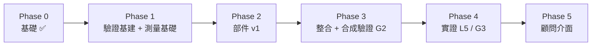

# 工項 Work Breakdown

預設決策（可改）：Python · MIT · 先服務**顧問** · 側寫先用**結構化問卷** · MVP 限定 **商管 × 數據 × 工程管理**。

## 工項完成的定義（Definition of Done）
每個工項關閉前必須同時滿足：
1. 程式與測試在同一個 PR，CI 全綠；
2. 對應的 L 層驗證已執行，結果寫進 PR 描述；
3. [REGISTER.md](REGISTER.md) 已更新：新假設、新盲區、狀態變化；
4. [VALIDATION.md](VALIDATION.md) §5 狀態表已更新；
5. 若修好盲區：探針的 `xfail` 已移除。

## 階段總覽

## Phase 0 — 基礎 ✅

| ID | 工項 | 部件 | 驗證 | 狀態 |
|---|---|---|---|---|
| W-00 | Repo、CI、規範 | — | CI | ✅ |
| W-01 | 資料契約與部件化程式結構 | 全部 | L2 | ✅ |
| W-02 | 驗證框架、假設與盲區登錄表、理論對照 | 全部 | L1 | ✅ |
| W-03 | C4.1 精確解 + 暴力法驗證；C2 v0；C1.2 v0 | C1/C2/C4 | L2 | ✅ |
| W-04 | 盲區探針：B-C1-2、B-C2-2、B-C2-3（皆確認失敗） | C1/C2 | L4 | ✅ |

## Phase 1 — 驗證基建 + 測量基礎

| ID | 工項 | 部件 | 產出 | 驗證／關卡 | 處理項目 | 依賴 |
|---|---|---|---|---|---|---|
| **W-10** | 合成學生產生器 v1 | C5.1 | 可設定需求分布、熟悉度、錨點（契合 × 名氣）、作答偏誤 | L2 分布檢查 | B-C1-2、B-C1-4/5 的情境基礎 | W-01 |
| **W-11** | 指標庫 | C5.2 | RMSE、τ、Recall@k、新穎相關率、覆蓋率、熱門度 KL、Brier、涵蓋率 | L2 手算測試 | — | W-01 |
| W-12 | 消融執行器 + 盲區情境集 | C5.3/C5.4 | 每個 B 項目一個情境設定 | L2 | 全部 B 項目 | W-10、W-11 |
| W-13 | 第二套生成模型（不同家族） | C5.5 | 潛在類別式生成器 | L2 | **S-1** | W-10 |
| W-14 | CIP 2020 + IPEDS 擷取與篩選 | C0.1 | `data/reference/`（附來源與日期） | L2 | B-C0-4 | — |
| W-15 | 職業橋接 v1 | C0.2 | $x^{occ}$（RIASEC） | G0 規格 → L2 | A-C0-2/3 | W-14 |
| **W-16** | 需求維度重新設計 | C1.1 | RIASEC + 領域維度；`docs/rubric.md` 評分準則；更新 `dimensions.py` 與合成資料 | G0（L1 理論審查） | **B-C1-1** | — |

## Phase 2 — 部件 v1

| ID | 工項 | 部件 | 產出 | 驗證／關卡 | 處理項目 | 依賴 |
|---|---|---|---|---|---|---|
| W-20 | 黃金標準 30 筆（兩位評分者） | C0.3 | 人工標註 + κ | L5 V-C0-3 | B-C0-3 | W-16 |
| W-21 | LLM 課程擷取（附原文片段） | C0.3 | $x^{cur}$ | L5 V-C0-2 ≥ 90% | B-C0-3、A-C0-5 | W-20 |
| W-22 | 融合與不一致審查佇列 | C0.4 | 最終 $x_p$ + 品質旗標 | L5 V-C0-4 | B-C0-1/2 | W-15、W-21 |
| W-23 | 錨點拆解 v1：名氣共變數 + 動機追問 | C1.2 | 探針 B-C1-2 轉為通過 | L3 V-C1-1、L4 | **B-C1-2** | W-10 |
| W-24 | 熟悉度擷取（聽過／能描述） | C1.4 | `familiar` 欄位來源 | L3 | B-C1-6、B-C2-1 | W-10 |
| W-25 | 題庫 + 資訊價值自適應選題 | C1.3 | 自適應問卷引擎 | L3 V-C1-2/3/4、L4 | B-C1-4/5 | W-16、W-10、W-11 |
| W-26 | 契合度 v1（考慮強度） | C2.1 | 新計分器，v0 保留 | L4 探針轉通過；L3 消融 | **B-C2-3** | W-12 |
| W-27 | 新穎度 v1（未知機率） | C2.2 | 以熟悉度與知名度估計 | L3 V-C2-2 | **B-C2-1** | W-24 |
| W-28 | 重排序 v1 + α/λ 掃描 | C2.3 | 字典序規則；參數敏感度報告 | L4 探針轉通過；L3 V-C2-3/4 | **B-C2-2**、B-C2-4 | W-12 |
| W-29 | 相關性評估器 | C4.2 | copula Monte Carlo | L2（ρ=0 一致）、L3 V-C4-2 | B-C4-1 | W-11 |
| W-2A | 穩健選擇 | C4.3 | 三種準則比較 | L3 V-C4-3 | B-C4-2 | W-29 |

## Phase 3 — 整合與合成驗證（G2）

| ID | 工項 | 產出 | 驗證／關卡 | 處理項目 | 依賴 |
|---|---|---|---|---|---|
| W-30 | 端到端管線（合成族群） | `C0→C1→C2→C4` 一鍵執行 | C0–C2、C4 的 G2 審查 | — | Phase 2 |
| W-31 | 跨生成模型重現 | 用 C5.5 重跑全部 L3 指標 | V-S-1：結論方向不變 | **S-1** | W-13、W-30 |
| W-32 | 合成驗證報告 | `results/synthetic-v1.md` | — | — | W-31 |

## Phase 4 — 實證（L5 / G3）

| ID | 工項 | 產出 | 驗證／關卡 | 處理項目 | 依賴 |
|---|---|---|---|---|---|
| W-40 | 同意書、個資流程、招募（10–20 位學生、2–3 位顧問） | 研究流程文件 | — | S-6 | — |
| W-41 | 側寫信效度研究 + 認知訪談 | 題庫 v2 | V-C1-5/6/7 | B-C1-3 | W-25、W-40 |
| W-42 | 核心使用者研究：新穎且相關 + 清單長度 | 結果報告 | V-C2-5 | B-C2-5、S-2 | W-30、W-40 |
| W-43 | 回溯測試 + 顧問盲評 | 結果報告 | V-C2-6/7 | S-3 | W-30、W-40 |
| W-44 | 錄取模型：資料稽核、階層模型、校準 | C3 v1 | V-C3-1 … 4 | B-C3-* | W-40 |
| W-45 | 效用擷取 | C4.4 v1 | 使用者研究 | B-C4-3 | W-42 |
| W-46 | 外部審查 + 登錄表更新 | 審查紀錄 | L6 | 全部 | W-41 … W-45 |

## Phase 5 — 顧問介面

| ID | 工項 | 處理項目 | 依賴 |
|---|---|---|---|
| W-50 | 側寫報告（需求剖面、推薦清單與理由、申請組合、不確定性） | — | G3 |
| W-51 | 顧問可調整需求向量，所有調整留紀錄並揭露給學生 | S-4 | W-50 |

## 建議起手順序
**W-10 + W-11（模擬與指標）** 和 **W-16（維度重設計）** 可以平行進行，而且是所有後續工項的前提：前者決定「怎麼量」，後者決定「量什麼」。

## 待決策
- [ ] MVP 領域是否確定為商管 × 數據 × 工程管理
- [ ] 驗證夥伴：可接觸到的顧問與學生
- [ ] Repo 維持 Private 或改 Public
